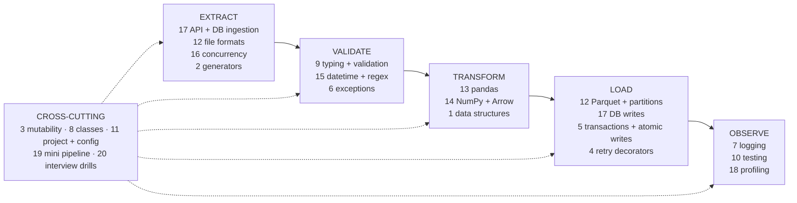
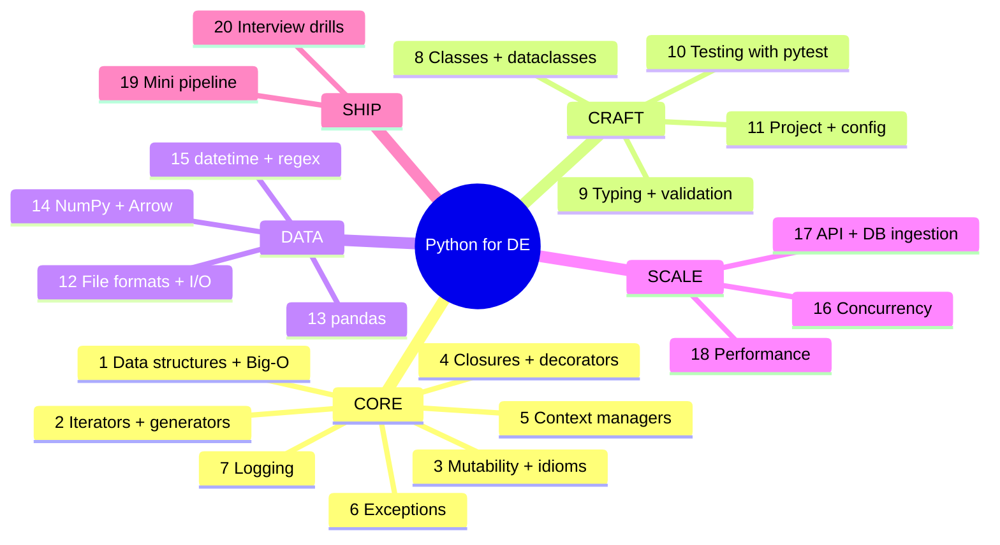

# Python for Data Engineering: Syllabus Map

A map to understand and memorize Python as it is used in data pipelines.
Put this file in `02-python/syllabus-map.md` and tick the checklist as you go.


## How to read this map

| Column | Meaning |
|---|---|
| **Time** | Hours for the lesson plus practice, at ladder depth (kid version up to lead level) |
| **Diff** | Difficulty, 1 (easy) to 5 (hard). I read "complexity" as difficulty. Algorithmic Big-O is in topic 1 and in the cheat card below |
| **Pipeline role** | Where the topic is used: **E**xtract, **V**alidate, **T**ransform, **L**oad, **O**bserve |
| **Weight** | How often it appears in interviews: H, M or L |
| **Priority** | P1 must learn, P2 should learn, P3 skim if short on time |
| **Status** | Taught means the lesson was delivered. Practice is still your job |

## Two memory schemes

**1. Five zones, in learning order:** **Core, Craft, Data, Scale, Ship.**
Language fundamentals, then writing it well, then handling data, then speed and integration, then building the whole thing.

**2. Five pipeline stages:** **E-V-T-L-O**, remembered as "Every Valid Transform Loads Okay."
Extract, Validate, Transform, Load, Observe. Every topic below attaches to one or more of these.

## Diagram 1: Where each topic lives in a pipeline



## Diagram 2: The five zones



## Zone 1: CORE (language fundamentals)

| # | Topic | What's inside | Time | Diff | Pipeline role | Weight | Priority | Status |
|---|---|---|---|---|---|---|---|---|
| 1 | Data structures + Big-O | list, dict, set, deque, heapq, Counter, defaultdict; costs; hidden O(n²) traps (`in` on a list, `pop(0)`, string `+=`) | 3h | 2 | T (everywhere) | H | P1 | Taught |
| 2 | Iterators + generators | iterable vs iterator, `yield`, lazy pipelines, `itertools`, chunking, the one-pass rule | 3h | 3 | E, T | H | P1 | Taught |
| 3 | Mutability + idioms | mutable defaults, shallow vs deep copy, `is` vs `==`, group/sort/top-k idioms | 2h | 2 | T | M | P2 | Taught |
| 4 | Closures + decorators | closures, `nonlocal`, late binding, `@wraps`, decorators with arguments, retry with backoff and jitter | 3h | 3 | L, E | M | P2 | Taught (ladder) |
| 5 | Context managers | `with`, `__enter__`/`__exit__`, `@contextmanager`, `ExitStack`, transactions, atomic writes | 2h | 3 | L | M | P2 | Taught (ladder) |
| 6 | Exceptions + failure policy | try/except/else/finally, hierarchy, chaining, custom errors, transient vs permanent vs bad-record | 2h | 3 | V, all | H | P1 | Taught |
| 7 | Logging | levels, logger tree, handlers, propagation, run-id context, JSON logs, logs vs metrics vs alerts | 2h | 3 | O | M | P2 | Taught (ladder) |

## Zone 2: CRAFT (writing it well)

| # | Topic | What's inside | Time | Diff | Pipeline role | Weight | Priority | Status |
|---|---|---|---|---|---|---|---|---|
| 8 | Classes + dataclasses | classes, `__init__`, `__repr__`, dataclasses, enums, ABCs and Protocols, composition over inheritance | 3h | 3 | all | M | P2 | Todo |
| 9 | Typing + validation | type hints, `Optional`, generics, mypy; runtime validation (dataclass checks, pydantic) | 2h | 3 | V | M | P2 | Todo |
| 10 | Testing with pytest | unit tests, fixtures, parametrize, mocking I/O, testing for idempotency and edge cases | 3h | 3 | O (quality) | H | P2 | Todo |
| 11 | Project + config | virtualenvs, `pyproject.toml`, env vars, secrets, `argparse`, structure of a pipeline repo | 2h | 2 | all | M | P3 | Todo |

## Zone 3: DATA (handling real data)

| # | Topic | What's inside | Time | Diff | Pipeline role | Weight | Priority | Status |
|---|---|---|---|---|---|---|---|---|
| 12 | File formats + I/O | CSV, JSON, JSONL, Parquet, Avro; compression; streaming reads; partitioned layouts; schema evolution | 3h | 3 | E, L | H | P1 | Todo |
| 13 | pandas essentials | indexing, groupby, merge, dtypes, `apply` vs vectorized, memory, chunked reads, NaN handling | 4h | 3 | T | H | P1 | Todo |
| 14 | NumPy + Arrow awareness | vectorization, broadcasting, Arrow/Polars at a conceptual level | 1.5h | 3 | T | L | P3 | Todo |
| 15 | datetime + regex | aware vs naive datetimes, UTC, DST traps, parsing, regex for log lines and validation | 2.5h | 3 | V, T | M | P2 | Todo |

## Zone 4: SCALE (speed and integration)

| # | Topic | What's inside | Time | Diff | Pipeline role | Weight | Priority | Status |
|---|---|---|---|---|---|---|---|---|
| 16 | Concurrency | the GIL, threads vs processes vs asyncio, queues, when each helps (I/O-bound vs CPU-bound) | 3h | 4 | E | M | P2 | Todo |
| 17 | API + DB ingestion | sessions and timeouts, pagination, rate limits and 429s, retries, idempotency keys, upserts, DB-API basics | 3h | 3 | E, L | H | P1 | Todo |
| 18 | Performance | profiling (`cProfile`), memory profiling, generators vs lists, avoiding quadratic traps, chunking | 2h | 4 | O | M | P3 | Todo |

## Zone 5: SHIP (put it together)

| # | Topic | What's inside | Time | Diff | Pipeline role | Weight | Priority | Status |
|---|---|---|---|---|---|---|---|---|
| 19 | Mini end-to-end pipeline | extract from an API, validate, transform, load to Parquet; idempotent, tested, logged, restartable | 4h | 4 | E-V-T-L-O | H | P1 | Todo |
| 20 | Interview drills | 30 timed problems: dedupe, top-k, merging streams, log parsing, sessionization, sliding windows | 6h | 3 | T | H | P1 | Todo |

## Time budget

| Group | Hours |
|---|---|
| Taught so far (topics 1 to 7) | 17h |
| Remaining P1 (12, 13, 17, 19, 20) | 20h |
| Remaining P2 (8, 9, 10, 15, 16) | 13.5h |
| Remaining P3 (11, 14, 18) | 5.5h |
| **Full map** | **56h** |

**Realistic path for the Dec 20 plan:** the P1 topics (20h) plus the P2 topics compressed into about 8h gives roughly 28h of remaining Python. The P3 topics are covered by reading the map and the memory hooks, with no dedicated lesson.

## Big-O cheat card (topic 1)

| Structure | Operation | Cost |
|---|---|---|
| list | append, index | O(1) |
| list | `x in lst`, `remove`, `insert(0, x)`, `pop(0)` | O(n) |
| dict / set | lookup, insert, delete, `in` | O(1) average |
| deque | append, appendleft, pop, popleft | O(1) |
| heapq | push, pop | O(log n) |
| heapq | `nlargest(k, it)` | O(n log k) |
| sorted() | sort | O(n log n) |
| str | `s += x` in a loop | O(n²) worst case, use `''.join(parts)` |

## Memory hooks: one picture per topic

| # | Topic | Picture to remember |
|---|---|---|
| 1 | Data structures | Kitchen tools: a set is a bouncer with a guest list, a deque is a queue at a counter, a heap is hospital triage |
| 2 | Generators | A water tap versus a bucket: you get one cup at a time, you never hold the whole lake |
| 3 | Mutability | A shared Google Doc versus a photocopy: edits on a shared doc show up for everyone |
| 4 | Decorators | Gift wrap: the present inside is unchanged, the wrapping adds behavior |
| 5 | Context managers | A library book: you must return it no matter what happened |
| 6 | Exceptions | A problem report climbing a chain of command |
| 7 | Logging | A ship's logbook, filed by reporters in a newsroom |
| 8 | Classes + dataclasses | A blueprint versus a house; a dataclass is a form with labeled boxes |
| 9 | Typing + validation | Signs versus a checkpoint: type hints are the signs, validation is the airport security check |
| 10 | Testing | Crash tests for cars: you break things on purpose before shipping |
| 11 | Project + config | A labeled toolbox; secrets are keys, never taped to the door |
| 12 | File formats | Shipping: CSV is loose boxes, Parquet is a standard container with a manifest |
| 13 | pandas | A spreadsheet on steroids; vectorized is an assembly line, `apply` is carrying each item by hand |
| 14 | NumPy + Arrow | The assembly line machine itself |
| 15 | datetime | World clocks: store ship's time (UTC), convert only for display |
| 16 | Concurrency | A kitchen: threads are cooks sharing one stove, processes are separate kitchens, asyncio is one cook who never stands staring at the oven |
| 17 | API ingestion | A busy shop: take a number (rate limits), flip through catalogue pages (pagination), reorder safely (idempotency) |
| 18 | Performance | Find the traffic jam before widening the road: profile first |
| 19 | Mini pipeline | A factory line, built end to end |
| 20 | Drills | Gym reps |

## Checklist (commit this)

```markdown
- [x] 1 Data structures + Big-O
- [x] 2 Iterators + generators
- [x] 3 Mutability + idioms
- [x] 4 Closures + decorators
- [x] 5 Context managers
- [x] 6 Exceptions + failure policy
- [x] 7 Logging
- [ ] 8 Classes + dataclasses
- [ ] 9 Typing + validation
- [ ] 10 Testing with pytest
- [ ] 11 Project + config
- [ ] 12 File formats + I/O
- [ ] 13 pandas essentials
- [ ] 14 NumPy + Arrow awareness
- [ ] 15 datetime + regex
- [ ] 16 Concurrency
- [ ] 17 API + DB ingestion
- [ ] 18 Performance
- [ ] 19 Mini end-to-end pipeline
- [ ] 20 Interview drills
```

## Spaced review (how to memorize this map)

1. **Day 0:** read the map, then redraw Diagram 1 on paper from memory.
2. **Day 1, 3, 7, 14:** cover the "Picture to remember" column and recall each topic's picture and its pipeline stage.
3. **Weekly:** pick one topic and explain it aloud in 2 minutes, from the kid version up to the lead-level layer.
4. **Before each mock:** list the five zones and the five pipeline stages from memory, then check yourself.
